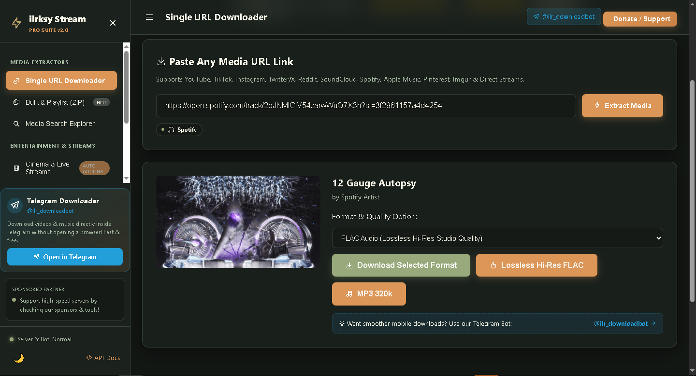
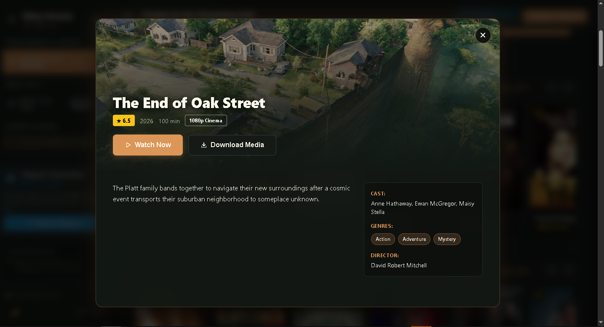
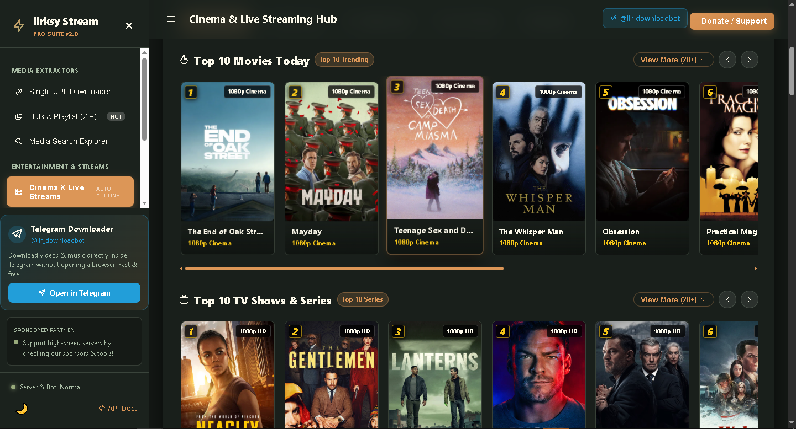
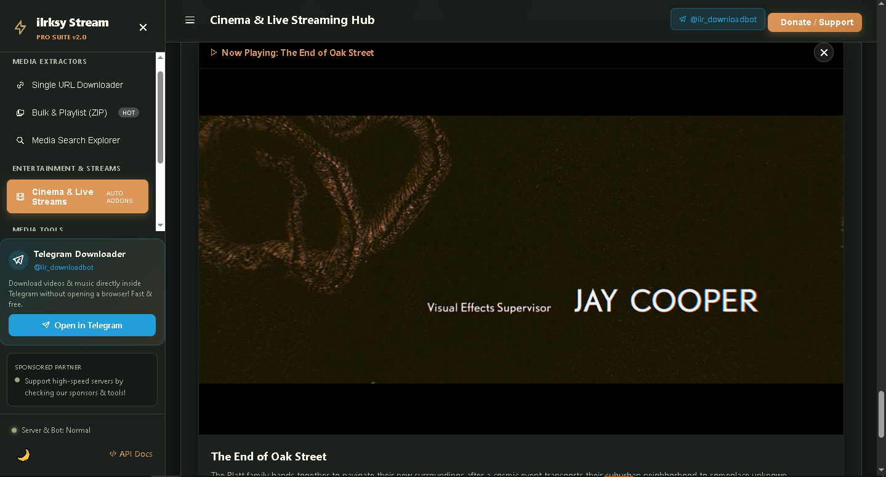
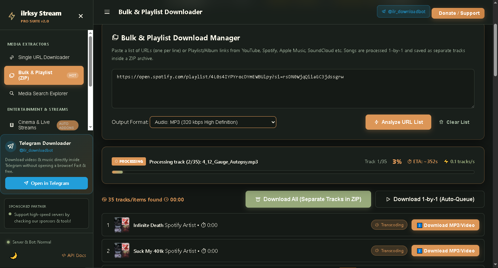
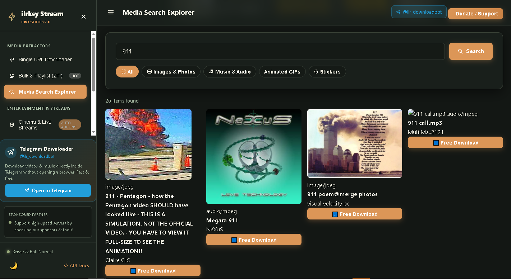

# 🎬 ilrksy Stream — Universal Media Downloader & Global Cinema Suite

<div align="center">

[](https://opensource.org/licenses/MIT)
[](https://www.python.org/)
[](https://fastapi.tiangolo.com)
[](https://github.com/video-dev/hls.js/)
[](https://t.me/ilr_downloadbot)
[](#)

**A high-performance, open-source streaming platform and universal media extractor featuring Netflix-grade UI, IPTV Live TV across 150+ countries, multi-provider embed streams, and automated Telegram bot integration.**

[✨ Features](#-key-features) • [📸 Previews](#-visual-previews) • [🚀 Quick Start](#-quick-start) • [📡 API Reference](#-api-endpoints) • [🌍 Worldwide IPTV](#-worldwide-live-tv) • [🤖 Telegram Bot](#-telegram-bot-integration) • [📄 License](#-license)

</div>

---

## 🌟 Visual Previews

### 1. Netflix-Style Cinema & Trending Rows


### 2. Worldwide Live TV (1 Row Per Country — Horizontal Sliders)


### 3. Rich Modal with Full Synopsis, Cast, Rating & Episode Catalog


### 4. TV Series Season & Episode Selector


### 5. Multi-Server Clean Player (No Pop-ups / Zero Redirects)


### 6. Country Navigation & Universal Live TV Hub


---

## ✨ Key Features

- 🍿 **Netflix-Grade Streaming Hub**:
  - **Horizontal 1-Row Sliders**: Clean 1-row sliders for Top 10 Trending Movies, Popular TV Series, and 3D Open Cinema.
  - **1 Row Per Country for Live TV**: Malaysia 🇲🇾, Japan 🇯🇵, Indonesia 🇮🇩, Singapore 🇸🇬, South Korea 🇰🇷, USA 🇺🇸, UK 🇬🇧, Saudi Arabia 🇸🇦, Turkey 🇹🇷, France 🇫🇷, Germany 🇩🇪, and more!
  - **Rich Synopsis Modal**: High-res backdrop posters, IMDb ratings, genre tags, cast, directors, runtime, and trailer overviews.
  - **Full TV Series Episode Browser**: Multi-season dropdown with individual episode thumbnails and descriptions.

- 🛡️ **Clean Player Engine (Anti-Popup & Ad-Free Embeds)**:
  - Default **VidLink Pro (Clean Next.js)** streaming engine with zero popup redirections.
  - **Multi-Server Switcher**: Instant switching between VidLink, VidSrc Direct Pro, VidSrc Fast, VidSrc PM, and SuperEmbed.
  - Client-side popup trap (`window.open` interceptor) to safeguard user experience.

- 📥 **Universal Media Extractor (yt-dlp & FFmpeg)**:
  - Extract and download videos, audio, reels, playlists, and images from 1,000+ websites (YouTube, TikTok, Instagram, Twitter/X, Reddit, Pinterest, Spotify, SoundCloud, Apple Music, etc.).
  - Single-click MP3/M4A/WAV extraction, format transcoding, and bulk playlist packaging into a single ZIP archive.

- 🤖 **Telegram Bot Integration (`@ilr_downloadbot`)**:
  - Native polling daemon for Telegram users to download videos, songs, and files directly inside chat.

- ⚡ **Optimized for High Performance**:
  - **GZip API Response Compression**: Ultra-lightweight JSON payloads with ~80% size reduction.
  - **60 FPS Hardware Acceleration**: `content-visibility: auto`, `contain-intrinsic-size`, and `will-change: transform` for buttery smooth slider performance.
  - **Background Cache Warmup**: 10,000+ IPTV channels and country metadata loaded asynchronously into memory.

---

## 🚀 Quick Start

### Prerequisites
- **Python 3.10+**
- **FFmpeg & FFprobe**
- **yt-dlp**

```bash
# Ubuntu / Debian
sudo apt update && sudo apt install -y python3 python3-pip ffmpeg
```

### Installation

1. **Clone the repository:**
```bash
git clone https://github.com/ilrksy/ilrksy-stream.git
cd ilrksy-stream
```

2. **Install dependencies:**
```bash
pip install -r requirements.txt
```

3. **Run the application:**
```bash
python run.py
```

4. **Access the Web App:**
Open your browser and navigate to:
```
http://localhost:8000
```

---

## 📡 API Endpoints

| Method | Endpoint | Description |
|---|---|---|
| `GET` | `/api/health` | System health check, binary verification (FFmpeg, yt-dlp) & cache telemetry |
| `GET` | `/api/stream/catalog` | Fetch categorized movies, series, or worldwide Live TV channels (`?category=live_tv&country=MY`) |
| `GET` | `/api/stream/countries` | List all 150+ available countries with Live TV counts & flags |
| `GET` | `/api/stream/details/{type}/{id}`| Rich Cinemeta / TVMaze metadata, cast, synopsis, and episode lists |
| `GET` | `/api/stream/search` | Search movies, series, and live feeds across the open web |
| `POST` | `/api/extract` | Extract metadata and download formats from any media URL |
| `POST` | `/api/batch/job` | Package multiple playlist tracks into a single ZIP archive |
| `GET` | `/api/download` | High-speed media streaming with HTTP 206 Range support |

---

## 🌍 Worldwide Live TV

`ilrksy Stream` connects to open-source IPTV feeds worldwide:

- 🇲🇾 **Malaysia**: 8TV, Awesome TV, Berita RTM, DidikTV KPM, Drama Sangat, Okey, RTM ASEAN
- 🇯🇵 **Japan**: NHK World HD, Tokyo MX, Anime/News feeds
- 🇮🇩 **Indonesia**: Kompas TV, MetroTV, TVRI, TVOne
- 🇸🇬 **Singapore**: CNA (Channel NewsAsia), Channel 5, Channel 8, Suria, Vasantham
- 🇰🇷 **South Korea**: Arirang TV World, KBS World, K-Pop Channels
- 🇺🇸 **United States**: CBS News, ABC News, Bloomberg TV, NBC
- 🇬🇧 **United Kingdom**: Sky News, Clubland Dance TV, NOW Music TV
- 🇸🇦 **Saudi Arabia & 🇶🇦 Qatar**: Quran TV, Sunnah TV, Al Jazeera Arabic

---

## 🤖 Telegram Bot Integration

The backend includes a built-in Telegram Bot engine (`@ilr_downloadbot`).

To configure your own bot token, set the environment variable:
```bash
export TELEGRAM_BOT_TOKEN="your_bot_token_here"
```

---

## 📄 License

Distributed under the **MIT License**. See `LICENSE` for more information.

---

<div align="center">
  <b>Built with ❤️ by ilrksy</b>
</div>
